# Node + React + Postgres — Production-Style Local Platform

A simple full-stack app (React + Node.js/Express + PostgreSQL) taken through
six stages: containerization, Kubernetes, Ingress/API gateway, CI/CD,
platform services (Redis/queue/search + simulated read/write DB), and
observability/scaling.

## Repo structure

```
.
├── backend/                  # Express API + BullMQ worker
├── frontend/                 # React (Vite) app
├── 
├── 
├── 
├── 
├── k8s/                      # Namespaces, Deployments, Services, Ingress
├── observability/            # Prometheus, Grafana, Fluent Bit, Loki, HPA
└── .github/workflows/ci-cd.yml
```

---

# Cloudly DevOps Assessment — Task 1

## Docker Compose Local Development Environment

### Overview

Task 1 configures a React/Vite frontend, Node.js backend, and PostgreSQL database using Docker Compose.

The objective is to run the application locally with containerized services, persistent database storage, environment-based configuration, service health checks, and frontend-to-backend communication.

### Architecture

```text
Browser
   |
   | http://localhost:8080
   v
Frontend Container (NGINX)
   |
   | /api/ requests
   v
Backend Container (Node.js)
   |
   | PostgreSQL connection
   v
PostgreSQL Container
   |
   v
Named Volume: postgres_data
```

### Technology Stack

- Docker and Docker Compose
- React / Vite
- Node.js
- NGINX
- PostgreSQL 16 Alpine
- Environment variables and Docker named volumes
- Container health checks

### Project Structure

```text
.
├── backend/
├── frontend/
├── docs/
│   └── screenshots/
├── Dockerfile.backend
├── Dockerfile.frontend
├── docker-compose.yaml
├── nginx.conf
├── .dockerignore
├── .env
└── README.md
```

### Configuration

The `.env` file provides local configuration for the database, backend, frontend port, and other service settings.

Example values:

```dotenv
POSTGRES_DB=appdb
POSTGRES_USER=appuser
POSTGRES_PASSWORD=replace_with_local_password

DB_HOST=postgres
DB_PORT=5432
DB_NAME=appdb
DB_USER=appuser
DB_PASSWORD=replace_with_local_password

FRONTEND_PORT=8080
```

**Security:** The actual `.env` file must not be committed to Git. Use `.env.example` with placeholder values for sharing configuration. Do not include real passwords in screenshots.

### Docker Compose Services

| Service         | Purpose                                                         |
| --------------- | --------------------------------------------------------------- |
| `frontend`      | Serves the built frontend through NGINX and publishes port 8080 |
| `backend`       | Runs the Node.js API on container port 3000                     |
| `postgres`      | Stores application data in PostgreSQL                           |
| `postgres_data` | Persists PostgreSQL data across container recreation            |
| `app-network`   | Allows containers to communicate by service name                |

### Implementation Details

#### 1. Containerized frontend and backend

Separate Dockerfiles are used for the frontend and backend. The frontend Dockerfile builds the Vite application and serves the resulting static files through NGINX.

#### 2. Internal service communication

The backend connects to PostgreSQL using the Compose service hostname `postgres`, not `localhost`. Within a container, `localhost` refers to that same container.

#### 3. Persistent database storage

The named volume `postgres_data` is mounted at `/var/lib/postgresql/data`. This preserves database files when the PostgreSQL container is stopped or recreated.

#### 4. Health checks and startup order

PostgreSQL uses `pg_isready` to check database readiness. The backend health check requests `/api/health`.

Compose uses `depends_on` with `condition: service_healthy` so dependent services wait for the configured health checks.

#### 5. Frontend API routing

NGINX proxies API requests to the backend service. The frontend accesses the API through the same public origin, avoiding the need to expose the backend port directly to the host.

### Setup and Execution

#### Step 1 — Validate Compose configuration

```bash
docker compose config
```

This checks whether the Compose file and interpolated configuration are valid.

#### Step 2 — Build and start services

```bash
docker compose up -d --build
```

This builds the application images and starts the services in detached mode.

#### Step 3 — Check service status

```bash
docker compose ps
```

Check that the frontend and backend are running and the database is healthy.

#### Step 4 — View service logs

```bash
docker compose logs --tail=100
```

To inspect one service:

```bash
docker compose logs backend
docker compose logs postgres
docker compose logs frontend
```

#### Step 5 — Verify the application

Open the frontend:

```text
http://localhost:8080
```

Check the API health endpoint:

```bash
curl -i http://localhost:8080/api/health
```

The health endpoint should return a successful HTTP response.

#### Step 6 — Verify PostgreSQL

```bash
docker compose exec postgres \
  psql -U appuser -d appdb \
  -c '\dt'
```

This lists tables in the configured database. Replace the username or database name if your `.env` uses different values.

#### Step 7 — Stop the services

```bash
docker compose down
```

This stops and removes the Compose containers and network but preserves the named database volume.

**Warning:** `docker compose down -v` also removes the named volume and can delete local database data. Do not use it unless you intentionally want to remove that data.

### Screenshots and Evidence

#### 1. Docker Compose Service Status

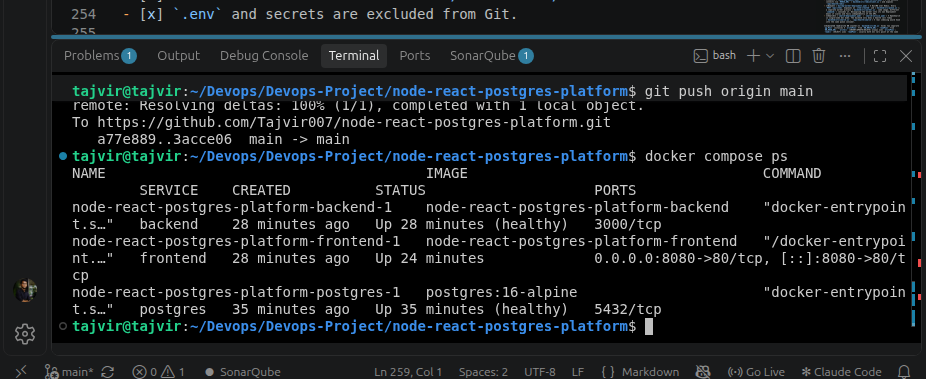

Shows the status of the frontend, backend, and PostgreSQL services.

#### 2. Frontend Application

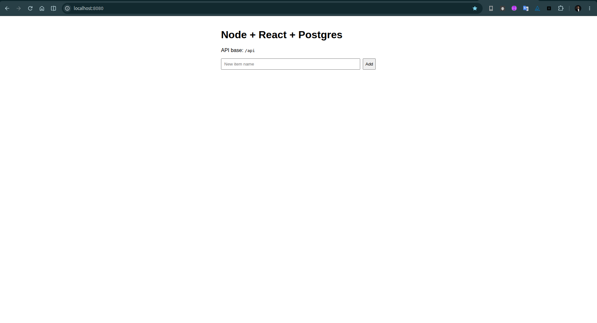

Shows the application running in the browser.

#### 3. API Health Check

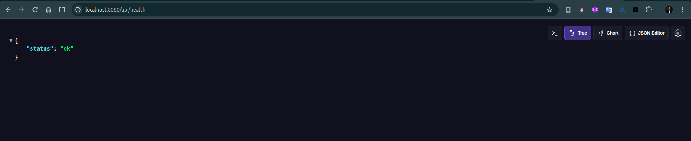

Shows the HTTP response from the backend health endpoint through NGINX.

#### 4. PostgreSQL Verification

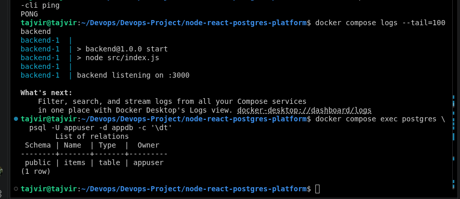

Shows the database table listing or another successful database verification command.

> Replace these image paths with your actual screenshot filenames. Remove any screenshot section for which you do not have evidence.

### Task 1 Completion Checklist

- [x] Frontend Docker image builds successfully.
- [x] Backend Docker image builds successfully.
- [x] PostgreSQL starts with the configured database and credentials.
- [x] Database data uses a named volume.
- [x] Health checks are configured and verified.
- [x] Frontend is accessible through the published host port.
- [x] API health endpoint responds successfully.
- [x] PostgreSQL connectivity and schema are verified.
- [x] Screenshots are saved under `docs/screenshots/`.
- [x] `.env` and secrets are excluded from Git.

### Notes

This document records the local Docker Compose implementation for Task 1. Kubernetes, CI/CD, caching, search, monitoring, and logging belong to later assessment tasks.


## Task 2 — Kubernetes


cd ~/Devops/Devops-Project/node-react-postgres-platform

mkdir -p docs/screenshots

cat >> README.md <<'EOF'

---

# Task 2 — Kubernetes Deployment

## Objective

Deploy the React frontend, Node.js backend, PostgreSQL database, and Redis service to a local Kubernetes cluster using Kind.

## Architecture

```text
                 Browser
                    |
                    | localhost:8081
                    v
          Kubernetes Frontend Service
                    |
                    v
             Frontend Pod
              NGINX :80

          Backend Service
                    |
                    v
              Backend Pod
              Node.js :3000
               /       \
              v         v
     PostgreSQL       Redis
     Service :5432   Service :6379
          |               |
          v               v
     PostgreSQL Pod    Redis Pod
          |
          v
     PersistentVolumeClaim
        postgres-pvc
```

> Note: Frontend and Backend were tested separately using `kubectl port-forward`. End-to-end frontend-to-backend routing must be verified separately if the NGINX configuration does not proxy `/api` requests.

## Kubernetes Resources

| Resource | Name | Purpose |
|---|---|---|
| Namespace | `dev` | Isolates application resources |
| ConfigMap | `app-config` | Stores non-sensitive application settings |
| Secret | `app-secrets` | Stores database credentials |
| Deployment | `frontend` | Runs the NGINX-based React frontend |
| Service | `frontend` | Exposes frontend inside the cluster |
| Deployment | `backend` | Runs the Node.js API |
| Service | `backend` | Exposes backend internally on port 3000 |
| Deployment | `postgres` | Runs PostgreSQL |
| Service | `postgres` | Exposes PostgreSQL internally on port 5432 |
| PVC | `postgres-pvc` | Provides persistent database storage |
| Deployment | `redis` | Runs Redis |
| Service | `redis` | Exposes Redis internally on port 6379 |

## Directory Structure

```text
k8s/
├── namespace-dev.yaml
├── postgres.yaml
├── redis.yaml
├── backend.yaml
└── frontend.yaml

docs/
└── screenshots/
    ├── task2-kubernetes-resources.png
    ├── task2-frontend.png
    ├── task2-backend-health.png
    └── task2-postgres-pvc.png
```

## Deployment Steps

### 1. Verify the Kind cluster

```bash
kubectl cluster-info --context kind-dev-cluster
kubectl get nodes
```

### 2. Apply PostgreSQL and Redis

```bash
kubectl apply -f k8s/postgres.yaml
kubectl apply -f k8s/redis.yaml
```

### 3. Verify the database storage

```bash
kubectl get pvc -n dev
```

Expected result: `postgres-pvc` should have status `Bound`.

### 4. Deploy the backend

```bash
kubectl apply -f k8s/backend.yaml
kubectl rollout status deployment/backend -n dev
```

The backend uses the `app-config` ConfigMap and `app-secrets` Secret for its environment configuration.

### 5. Deploy the frontend

```bash
kubectl apply -f k8s/frontend.yaml
kubectl rollout status deployment/frontend -n dev
```

### 6. Verify all application resources

```bash
kubectl get deployments,pods,services -n dev
kubectl get pvc -n dev
kubectl get endpoints -n dev
```

## Application Verification

### Frontend

Forward local port 8081 to the Kubernetes frontend Service:

```bash
kubectl port-forward -n dev service/frontend 8080:80
```

Open the following URL in a browser:

```text
http://localhost:8080
```

Check the HTTP response from a separate terminal:

```bash
curl -I http://localhost:8080
```

Expected result: `HTTP/1.1 200 OK`.

### Backend Health Checks

Forward local port 3001 to the Kubernetes backend Service:

```bash
kubectl port-forward -n dev service/backend 3001:3000
```

Run these commands in a separate terminal:

```bash
curl -i http://127.0.0.1:3001/api/health/live
curl -i http://127.0.0.1:3001/api/health/ready
curl -i http://127.0.0.1:3001/api/health/redis
```

The three endpoints returned HTTP 200 during testing.

### PostgreSQL Storage Verification

```bash
kubectl get pvc -n dev
kubectl get pods -n dev
kubectl logs -n dev deployment/postgres --tail=50
```

Expected result: the PVC is `Bound`, and the PostgreSQL Pod is `Running`.

## Screenshots

### 1. Kubernetes Resources

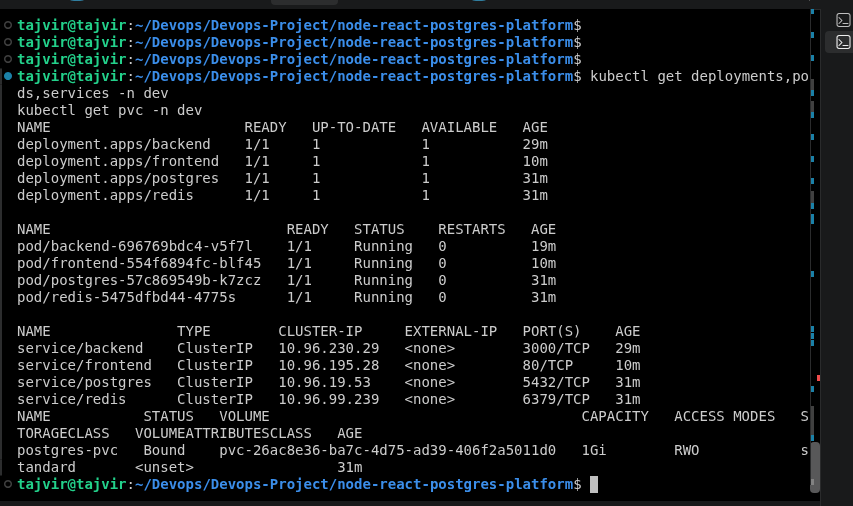

*Evidence: Deployments, Pods, Services, and their readiness status.*

### 2. Frontend Application

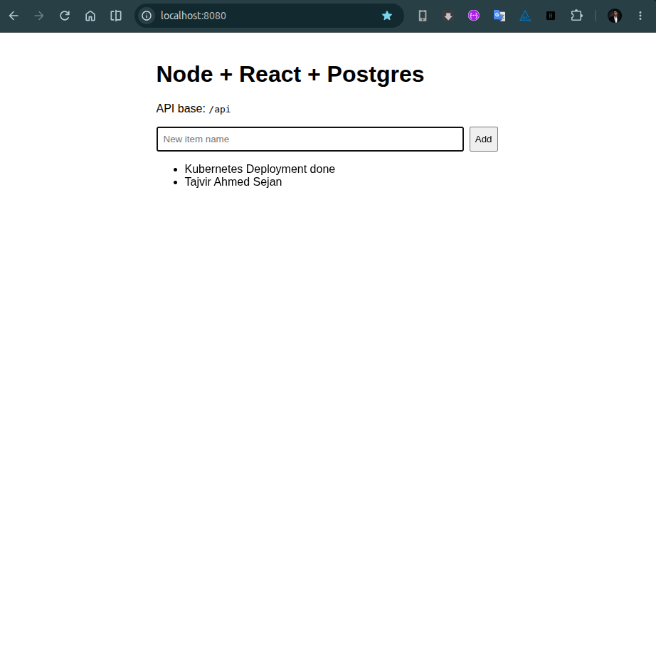

*Evidence: React frontend successfully served by NGINX through the Kubernetes frontend Service.*

### 3. Backend Health Checks

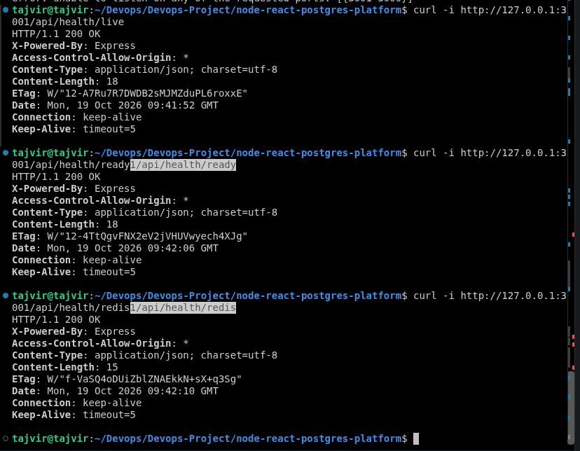

*Evidence: HTTP responses from the backend liveness, readiness, and Redis health endpoints.*

### 4. PostgreSQL Persistent Storage

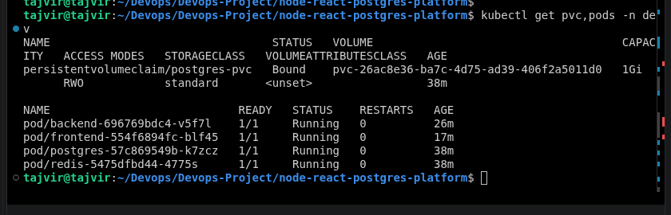

*Evidence: PostgreSQL PVC status is Bound and the database Pod is Running.*

## Troubleshooting

### Local port is already in use

If port 3000 or 8080 is occupied by another application, use different local ports:

```bash
kubectl port-forward -n dev service/backend 3001:3000
kubectl port-forward -n dev service/frontend 8081:80
```

The local port is on the left; the Kubernetes Service port is on the right.

### Backend CreateContainerConfigError

Inspect the Pod events:

```bash
kubectl describe pod -n dev -l app=backend
kubectl describe secret app-secrets -n dev
```

Verify that every key referenced by `secretKeyRef` exists in the Secret. In this setup, the backend requires `DB_USER` and `DB_PASSWORD`.

### Inspect application logs

```bash
kubectl logs -n dev deployment/backend --tail=100
kubectl logs -n dev deployment/frontend --tail=100
kubectl logs -n dev deployment/postgres --tail=100
kubectl logs -n dev deployment/redis --tail=100
```

## Current Status

- [x] Kind cluster is available.
- [x] PostgreSQL Deployment and Service are running.
- [x] PostgreSQL PVC is Bound.
- [x] Redis Deployment and Service are running.
- [x] Backend Deployment and Service are running.
- [x] Backend health endpoints return HTTP 200.
- [x] Frontend Deployment and Service are running.
- [x] Frontend is accessible using port-forward.
- [ ] Verify frontend-to-backend API routing end to end.
- [ ] Complete any required external frontend exposure using NodePort or Ingress.

EOF


## Task 3 — Ingress / API Gateway

# Task 3 — NGINX Ingress

## Objective

Configure NGINX Ingress to route frontend and backend API traffic through a single hostname in the local Kind Kubernetes cluster.

## Architecture

```text
                  Browser
                     |
                     | node-react.local:8081
                     v
          NGINX Ingress Controller
                     |
             Ingress: ingress-dev
                /          \
               /            \
              v              v
      Frontend Service   Backend Service
           :80                :3000
              |                |
              v                v
        Frontend Pod      Backend Pod
         NGINX :80       Node.js :3000
```

**Routing rules:**

- `/` → Frontend Service
- `/api` → Backend Service

Note: Port `8081` is used for local testing through `kubectl port-forward`. The port-forward must remain running during testing.

## Kubernetes Resources

| Resource | Name | Purpose |
|---|---|---|
| Namespace | `ingress-nginx` | Runs the NGINX Ingress Controller |
| Deployment | `ingress-nginx-controller` | Processes incoming HTTP requests |
| Service | `ingress-nginx-controller` | Exposes the Ingress Controller |
| Namespace | `dev` | Contains application resources |
| Ingress | `ingress-dev` | Routes frontend and API traffic |
| Service | `frontend` | Exposes the frontend on port 80 |
| Service | `backend` | Exposes the backend on port 3000 |

## Directory Structure

```text
k8s/
├── namespace-dev.yaml
├── postgres.yaml
├── redis.yaml
├── backend.yaml
├── frontend.yaml
└── ingress.yaml

docs/
└── screenshots/
    ├── task3-ingress-resources.png
    ├── task3-ingress-rules.png
    ├── task3-frontend-browser.png
    ├── task3-network-api-games.png
    └── task3-api-health.png
```

## Deployment Steps

### 1. Verify the Kind Cluster and Ingress Controller

```bash
kubectl cluster-info --context kind-dev-cluster
kubectl get nodes

kubectl get pods,services -n ingress-nginx
kubectl get deployments,pods,services -n dev
```

### 2. Configure the Ingress Resource

Create the manifest:

```bash
nano k8s/ingress.yaml
```

Add the following configuration:

```yaml
apiVersion: networking.k8s.io/v1
kind: Ingress
metadata:
  name: ingress-dev
  namespace: dev
spec:
  ingressClassName: nginx
  rules:
    - host: node-react.local
      http:
        paths:
          - path: /api
            pathType: Prefix
            backend:
              service:
                name: backend
                port:
                  number: 3000
          - path: /
            pathType: Prefix
            backend:
              service:
                name: frontend
                port:
                  number: 80
```

The `/api` path routes requests to the backend, while `/` routes requests to the frontend.

### 3. Apply the Ingress Configuration

```bash
kubectl apply -f k8s/ingress.yaml
```

Verify the Ingress resource and routing rules:

```bash
kubectl get ingress -n dev
kubectl describe ingress ingress-dev -n dev
```

Verify the Service endpoints:

```bash
kubectl get endpointslices -n dev \
  -l kubernetes.io/service-name=frontend

kubectl get endpointslices -n dev \
  -l kubernetes.io/service-name=backend
```

### 4. Configure the Local Hostname

Check whether the hostname is already configured:

```bash
grep -n "node-react.local" /etc/hosts
```

If no entry exists, add it:

```bash
echo "127.0.0.1 node-react.local" | sudo tee -a /etc/hosts
```

### 5. Start Port Forwarding

Run this command in a separate terminal and keep it running:

```bash
kubectl port-forward -n ingress-nginx \
  service/ingress-nginx-controller 8081:80
```

Open the frontend in a browser:

```text
http://node-react.local:8081/
```

## Application Verification

### Frontend

```bash
curl -i -H "Host: node-react.local" \
  http://127.0.0.1:8081/
```

Expected result: The frontend returns a successful HTTP response.

### Backend Health Check

```bash
curl -i -H "Host: node-react.local" \
  http://127.0.0.1:8081/api/health
```

### Backend Games API

```bash
curl -i -H "Host: node-react.local" \
  http://127.0.0.1:8081/api/games
```

Expected result: The requests reach the backend through the Ingress routing rules and return the backend's HTTP response.

## Screenshots

### 1. Ingress Resources

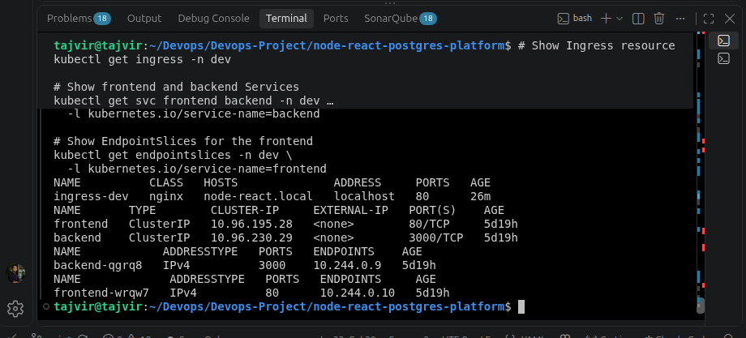

Evidence: Ingress resource, frontend and backend Services, and their endpoints.

### 2. Ingress Routing Rules

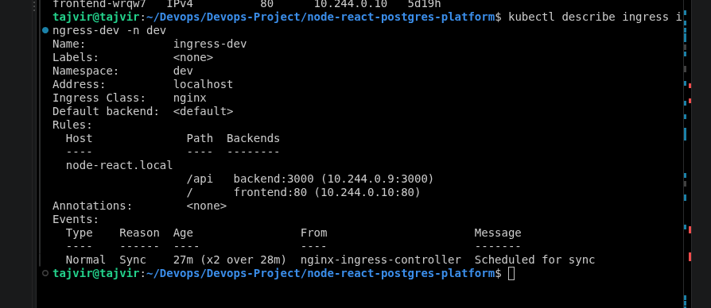

Evidence: `kubectl describe ingress ingress-dev -n dev`, showing the hostname, paths, and backend Services.

### 3. Frontend Application

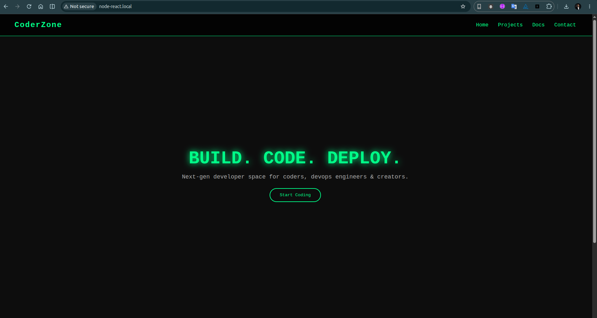

Evidence: Frontend successfully accessible at `http://node-react.local:8081/`.

### 4. Backend API Request

**File:** `task3-network-api-games.png`

Evidence: Browser DevTools Network tab showing the `/api/games` request and response.

### 5. Backend Health Check

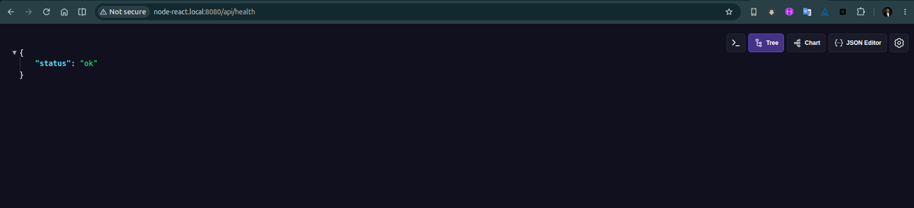

Evidence: Successful response from the backend `/api/health` endpoint through Ingress.

## Troubleshooting

### Local Port Is Already in Use

Use another available local port, such as `8081`:

```bash
kubectl port-forward -n ingress-nginx \
  service/ingress-nginx-controller 8081:80
```

The local port is on the left; the Service port is on the right.

### Ingress Has No Endpoints

```bash
kubectl get pods -n dev
kubectl get services -n dev
kubectl get endpointslices -n dev
kubectl describe ingress ingress-dev -n dev
```

Check that the frontend and backend Pods are running and their Services have endpoints.

### Inspect Ingress Controller Logs

```bash
kubectl logs -n ingress-nginx \
  deployment/ingress-nginx-controller --tail=100
```

## Current Status

- Kind cluster is available.
- NGINX Ingress Controller is installed.
- Ingress resource is configured for `node-react.local`.
- `/` is configured to route to the frontend Service.
- `/api` is configured to route to the backend Service.
- Verify frontend access through the Ingress port-forward.
- Verify `/api/health` and `/api/games` through the Ingress.
- Collect the required screenshots.

**Note:** The Current Status checklist should reflect the actual results of your tests. Do not mark a verification step as completed until you have confirmed it successfully.


# Task 4 — CI/CD & Multi-Environment Deployment

## Objective
Automate application validation, Docker image building, GHCR publishing, and Kubernetes deployment using GitHub Actions.

## 1. Workflow Overview

```text
Git Push / Pull Request
        |
        v
GitHub Actions
        |
        v
Validate Frontend & Backend
        |
        v
Build Docker Images
        |
        v
Push Images to GHCR
        |
        v
Deploy to Kubernetes
        |
        v
Verify Deployment
```

## 2. Branch-to-Environment Mapping

| Branch | Kubernetes Namespace |
|---|---|
| `main` / `master` | `dev` |
| `pre-release/v*` | `preprod` |
| `release/v*` | `release` |

## 3. CI/CD Workflow

Workflow file:

```text
.github/workflows/ci-cd.yml
```

The workflow performs these steps:

1. Installs frontend and backend dependencies.
2. Builds the frontend and runs backend tests.
3. Builds frontend and backend Docker images.
4. Pushes images to GitHub Container Registry (GHCR).
5. Tags images using branch name and short commit SHA.
6. Updates Kubernetes manifests with the correct image and namespace.
7. Deploys the application and verifies rollout status.

## 4. Self-hosted Runner

Since the Kubernetes cluster runs locally using kind, the deployment job uses a self-hosted runner.

Start the runner:

```bash
cd ~/Devops/Devops-Project/node-react-postgres-platform/actions-runner
./run.sh
```

Keep the runner running while the workflow executes.

## 5. Push Changes to GitHub

```bash
cd ~/Devops/Devops-Project/node-react-postgres-platform

git add .github/workflows/ci-cd.yml
git commit -m "feat: add CI/CD pipeline for Task 4"
git push origin main
```

If the changes are already committed, skip the commit commands.

## 6. Verify Deployment

Check Kubernetes resources:

```bash
kubectl get deployments,pods,services -n dev
```

Verify frontend and backend rollouts:

```bash
kubectl rollout status deployment/frontend -n dev
kubectl rollout status deployment/backend -n dev
```

Check GHCR packages from the repository's **Packages** section:

https://github.com/Tajvir007?tab=packages

Confirm that frontend and backend images have been published.

## 7. Rollback

The workflow supports manual rollback through GitHub Actions.

Alternatively, run:

```bash
kubectl rollout undo deployment/frontend -n dev
```

For the backend:

```bash
kubectl rollout undo deployment/backend -n dev
```

Verify the rollout after rollback.

## 8. Screenshots

Save screenshots inside `docs/screenshots/`.

| Screenshot | Filename |
|---|---|
| Successful GitHub Actions workflow | `task4-github-actions.png` |
| Frontend and backend GHCR packages | `task4-ghcr-packages.png` |
| Kubernetes deployment status | `task4-kubernetes.png` |
| Rollback verification | `task4-rollback.png` |

Add screenshots using Markdown:


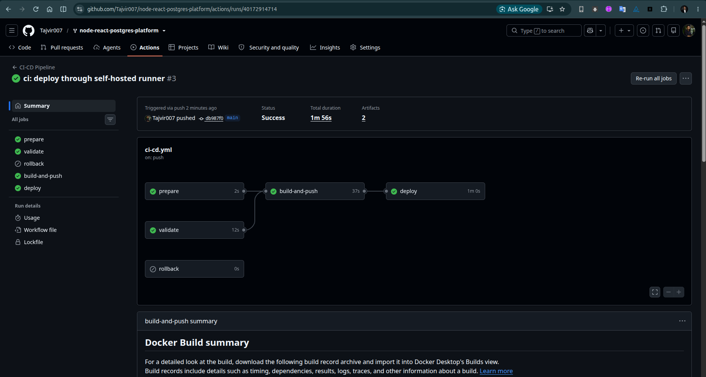

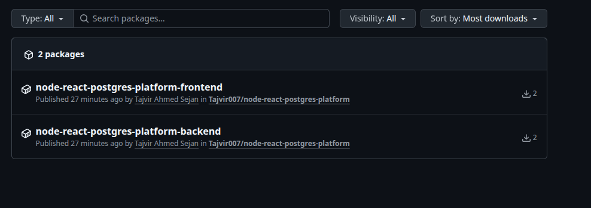

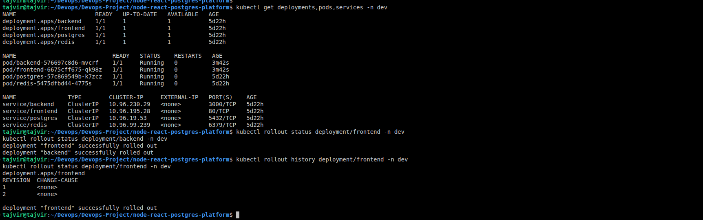


## Summary

Task 4 automates application validation, Docker image publishing, and Kubernetes deployment through GitHub Actions. The pipeline also supports deployment verification and rollback.

## Task 5 — Platform Services: Redis, Queue, Search, Read/Write DB

Added to both `docker-compose.yml` and `k8s/`:
- **Redis** (`redis-deployment.yaml` / `redis-service.yaml`) — the backend
  connects via `REDIS_URL` (`backend/src/redisClient.js`) and exposes
  `/api/health/redis`.
- **Queue** (`bullmq-worker-deployment.yaml`) — BullMQ over Redis. Every
  `POST /api/items` enqueues an `item-created` job (`backend/src/queue.js`);
  a separate worker process (`backend/src/worker.js`, same image, different
  `command:`) consumes it. Decoupling the worker into its own Deployment
  means it scales and fails independently of the API.
- **Search** (`search-deployment.yaml` / `search-service.yaml`) — OpenSearch
  in single-node dev mode. The backend only does a health call today
  (`backend/src/search.js`, `/api/health/search`) — real indexing would hook
  into the same queue consumer.

**Simulated read/write DB cluster:** `backend/src/db.js` holds two separate
`pg.Pool` instances — `writePool` from `DB_WRITE_URL`, `readPool` from
`DB_READ_URL`. `write()` (INSERT/UPDATE/DELETE) always uses `writePool`;
`read()` (SELECT) uses `readPool`. Locally both env vars point at the same
Postgres instance, but the code already treats them as separate targets, so
pointing `DB_READ_URL` at a real replica later is a one-line config change —
no application code changes.

**Where routing logic lives:** in this repo it's explicit in application
code (`write()` vs `read()` helpers). The alternative is a DB proxy
(PgBouncer, ProxySQL, or a cloud-managed read/write splitter) that makes
routing transparent to the app — simpler application code, but another
component to operate and one more hop of latency.

**Replication lag:** a replica can be milliseconds to seconds behind the
primary. Anything that reads its own recent write — "did my update save?",
a redirect-after-POST that re-fetches the record, uniqueness checks before
an insert — must hit the writer/primary, not a replica, or it risks reading
stale data and behaving as if the write never happened.

## Task 6 — Observability, Scaling & Rate Limiting

`observability/`:
- **Prometheus** (`prometheus.yaml`) scrapes any pod annotated
  `prometheus.io/scrape: "true"` (the backend Deployment is annotated
  accordingly) in the `dev` namespace.
- **Grafana** (`grafana.yaml`) for dashboards on: backend CPU usage, backend
  memory usage, request rate & error rate, and replica count over time.
- **Fluent Bit** (`fluentbit-daemonset.yaml`) runs as a `DaemonSet` (one per
  node, so it picks up every pod's logs on that node regardless of which
  pods get scheduled where) and ships backend logs to **Loki**
  (`loki.yaml`).
- **HPA** (`hpa-backend.yaml`) scales the backend Deployment 2→6 replicas on
  CPU (70%) or memory (80%) utilization.

**What to alert on, and why:**
- **High error rate** (5xx / total requests) — the most direct signal
  something is actually broken for users, independent of load level.
- **High CPU / at max HPA replicas** — means the autoscaler is out of
  headroom; the next symptom is queueing and latency, not just slow scaling.
- **High p95/p99 latency** — catches degradation (slow queries, GC pauses,
  a struggling dependency) that error-rate and CPU alone can miss.
- **Sustained high request rate** without a matching replica increase —
  usually indicates the HPA is misconfigured or capped, not that traffic is
  fine.

**Verifying logs:** `kubectl logs -n dev daemonset/fluent-bit` to confirm
Fluent Bit is running and tailing files, then query Loki (via Grafana's
Explore view, `{job="backend"}`) to confirm entries are actually arriving
and are searchable/filterable by label.
# node-react-postgres-platform
# node-react-postgres-platform
# node-react-postgres-platform
# node-react-postgres-platform
